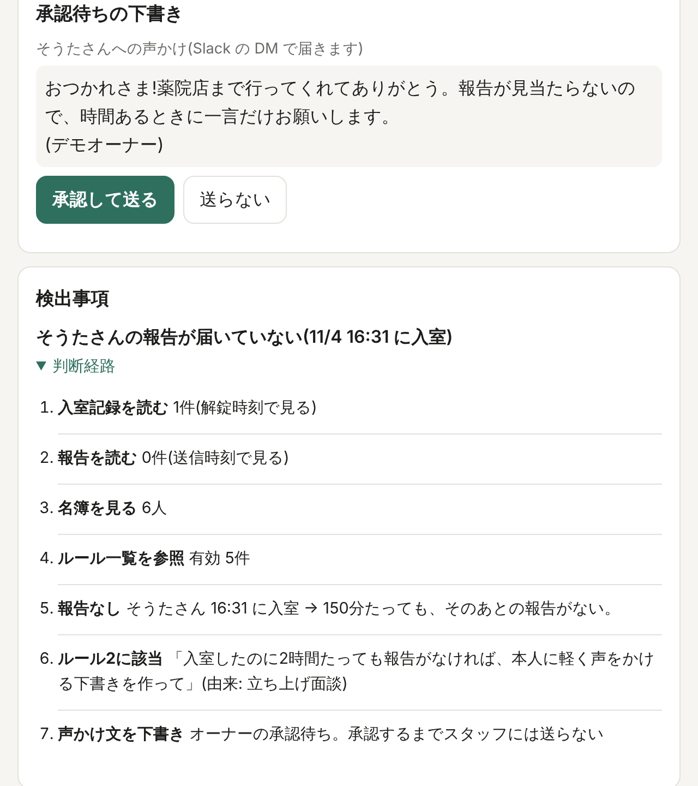
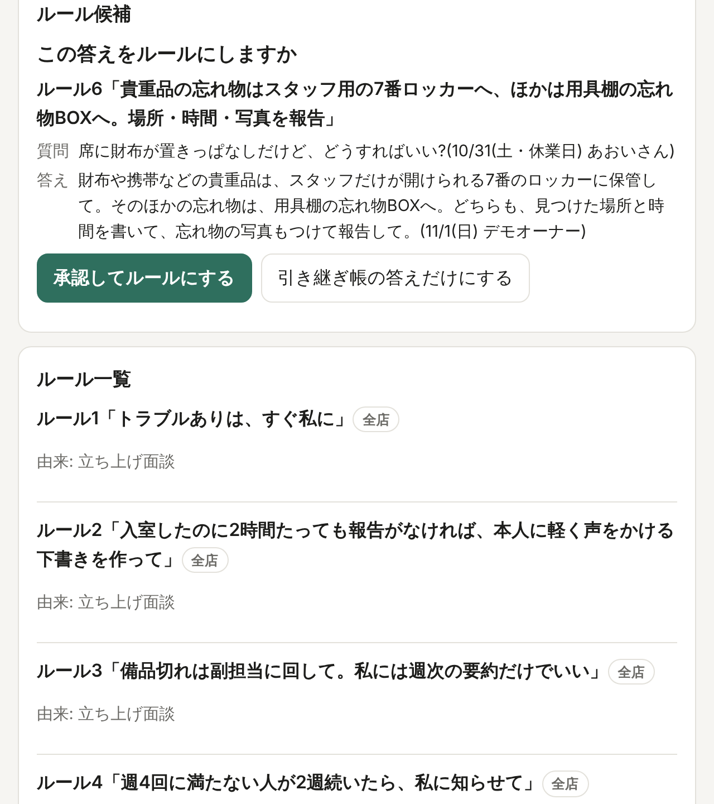
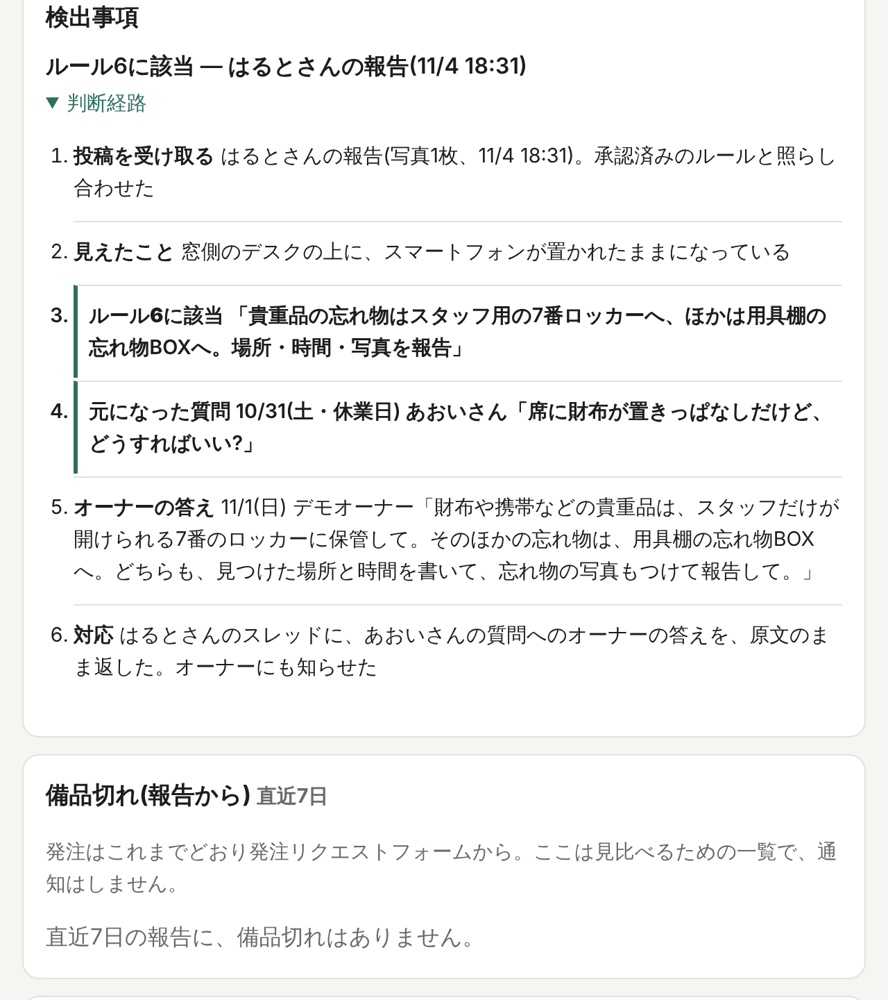
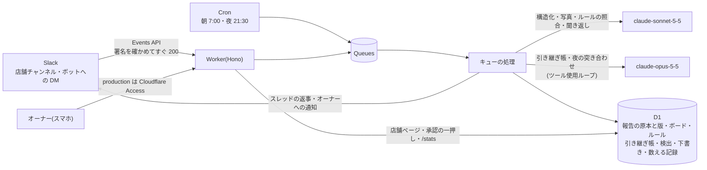

# hikitsugi

人手が足りないから、教える時間がない。だから答えが、一人の頭の中にしか残らない。

**無人自習室のオーナーが、清掃の「判断」と現場の「答え」を自分の頭から取り出し、ツールを持った Claude のエージェントと次のスタッフに受け継ぐ仕組み。**

30秒で読むなら:
- **誰の、何の課題か**: 福岡で無人自習室を3店舗運営するオーナー本人の課題。学生スタッフの質問に休日でも自分が数分で返し、清掃の判断も自分がしている。答えが自分の頭の中にしかない
- **山場の一往復**: 休みの日にスタッフが聞いた一言にオーナーが答える → その答えが承認で「ルール6」になる → 翌週、別のスタッフの写真にそのルールに当たる様子が写ると、スレッドにオーナーの答えが原文のまま返り、判断経路に「ルール6に該当(◯日のスタッフの質問から)」と出る
- **実店舗で動いている**: 11/4 から実店舗(西新店)で並走中。引き継ぎ帳と写真の要確認が動いている(数字は 11/6 夜に記入)
- **数字**: スタッフの質問は約2年で **114件**。**7割**は前に聞かれた話題。それなのに、次に使える形で残っていた答えは **4割未満**(114件中44件)
- **Claude の使い方**: ツール使用ループを Worker の中に書き、呼んだツールがそのまま判断経路になる。出典のない回答はコードが出さない。スタッフへの声かけはオーナーの承認を通す

> スタッフからの質問は約2年で114件。半分は営業時間外に来て、7割は前に答えたことのある内容で、それを自分が休日でも数分で返している。それなのに、次に使える形で残っていた答えは4割に満たない。答えは記録の中ではなく、自分の頭の中にある。清掃も同じで、報告を記録する仕組みは4か月前に自分で作ったが、入室記録との突き合わせは9月末に一度手でやって未報告が10件見つかったきり、声をかけるのも自分だ。記録は溜まるが、判断は人のまま、答えは自分の頭の中のまま。この仕組みは、その判断の部分をツールを持ったエージェントに渡し、同時に自分の運営の判断と現場の知識を、次のスタッフが受け継げる形に残す。

実店舗(11/4 から並走)で今動いているのは、引き継ぎ帳と写真の要確認。スタッフの質問には、前にオーナーが答えた言葉が出典つきで返るか、「確認します」と返ってオーナーに一度だけ届き、その答えが次に使える形で積まれる。清掃後の写真に汚れが見えれば、その箇所は「要確認」で止まり、本人が直すと完了になる(「実店舗での使われ方」)。

Built with Claude: Japan 2026 / テーマ1「あなたにしかない深さを」

## 何をするか(ある水曜日)

1. スタッフが店に入る(鍵の解錠が入室として記録される)。清掃を終え、いつもの Slack の店舗チャンネルに写真を送る
2. Claude が写真を見て清掃箇所と備品を拾い、スレッドに返す(「トイレットペーパーが残り1つに見えますが、合ってますか?」)。清掃後の写真に紙くずが見えれば、その箇所は「完了」にせず「要確認」で止め、片づけを1つだけ頼む
3. 夜の定時、エージェントが入室・報告・名簿・ルールを読むツールを順に呼んで突き合わせる。「19:10 入室、報告なし、2時間経過。ルール2に該当」と、呼んだツールがそのまま判断経路になり、責めない声かけ文を下書きする。**送るかどうかはオーナーが決める**
4. 休業日にスタッフが「暖房上げていい?」と聞くと、引き継ぎ帳が「25度までは自由(9/14 オーナー回答)」と**出典つきで**答える。答えのない質問は「確認します」と返し、オーナーに一度だけ聞く
5. オーナーの答えが「判断」なら、承認でルールになる。次に、別のスタッフの写真にそのルールに当たる様子が写ると、照合の判断経路に「ルール6に該当」と「元になった質問(◯日のスタッフの質問)」が出て、スレッドにはオーナーの答えが原文のまま返る。**スタッフが聞いた一言が、次から判断の基準になる**

## デモ

<p>



</p>

左から: 未報告の声かけの下書き(承認待ち)と判断経路 / 休業日の質問へのオーナーの答えから生まれたルール候補 / 別のスタッフの写真が、そのルール6に該当した判断経路。どれも demo の架空の店舗の画面。

真ん中と右の画面に出ている質問と答えの日付(10/31・11/1)は、休業日の表示を確かめるために、demo の D1 に日付をさかのぼらせて入れたもの。この仕組みはすべて 11/2 12:00 のキックオフ以降に作っている(コミット履歴のとおり)。休業日を足した seed(下の一行)で期間内の日付に撮り直して差し替える。

撮影のため、架空の店の休業日に撮影日(11/5〜11/7)を入れている([seed/demo.mjs](seed/demo.mjs) の `休業日.日付`。土曜は元から休業日)。

- **動画**: (11/8 に追加)
- **demo(架空の店舗・公開)**: https://hikitsugi-demo.h-kazuki.workers.dev/stores/tenjin
  - 店舗の一覧: https://hikitsugi-demo.h-kazuki.workers.dev/
  - 店舗ページは区画ごと(`?view=`。1画面に見どころを1つ): 今日のボード(完了・未清掃・繰り越し・要確認と根拠)/ 承認待ち(声かけの下書きとルール候補のキュー)/ 検出事項(一覧と判断経路の表。担い手を Claude・人の言葉・仕組みで分ける)/ ルール(由来つき。実行しないものは「登録のみ」)/ 備品切れ(報告から)/ デモの操作(入室を模擬する・夜の突き合わせと朝の定時をいま動かす)
  - 数字の画面(demo は架空データ): https://hikitsugi-demo.h-kazuki.workers.dev/stats / Claude の消費: https://hikitsugi-demo.h-kazuki.workers.dev/usage
  - Slack 側(受付・聞き返し・引き継ぎ帳の答え・声かけの DM)はデモ用ワークスペースで動かし、動画で見せる
- 店舗・スタッフ・質問はすべて架空(「サンプル自習室 天神店 / 薬院店」)。実店舗(production)は 11/4 から西新店で動いている。実店舗のデータは非公開の production 環境にだけある

## 数字(自分の店の、今の不便)

### 1. 問題の大きさ

| | |
|---|---|
| スタッフからの質問 | 約2年で **114件** |
| そのうち営業時間外 | **49%**(休日 35%、平日夜 14%) |
| そのうち過去に答えたことのある趣旨 | **68%**(空調だけで24件) |
| そのうち「していいか・仕様か」の判断 | **37%**(手順 36%、場所 27%。紙のマニュアルには書けない種類) |
| 今の返信 | 休日でも中央値 **2〜3分**。速いのは解決している証拠ではなく、代表が張りついている証拠 |
| 入室したのに報告がない | 9/28 に一度だけ手作業で照合して **10件**。手間がかかり、以後やれていない |
| 記録の仕組みだけの限界 | 同じ箇所を後から報告すると前の記録が消えていた。復元すると、繰り越し **441件** が実は **13件** だった |

### 2. 答えが残っていなかった証拠(過去の質問の流し直し)

| | |
|---|---|
| 当時の答えのうち、次に使える形で残っていたもの | 114件中 **44件**(39%)。67件は「今から行きます」のようなその場の対応、3件は答えなし |
| その時点の帳で、そのまま答えになる質問 | **3件**(Claude の判定。3件とも同じ1つの答えを指していた) |
| 引き継ぎ帳が出典つきで返した質問 | **1〜2件**(3回の実行で 2・1・2)。うち1件は当てはまらない答えだった(「限界」) |
| 出典のない回答 | **3回とも0件**(コードの保証が、実データでも崩れなかった。下の節) |

### 3. これから残る証拠(実稼働)

実店舗の `/stats` の件数。11/6 夜に記入する(「実店舗での使われ方」の表)。

### 流し直しの中身(11/4、実データ)

過去の質問114件を時系列に流し直した。帳に積めたのは、そのまま次に使える答え44件だけで、67件は「今から行きます」のようなその場の対応、3件は答えなしだった。その時点の帳でそのまま答えになる質問は3件(Claude の判定)。引き継ぎ帳は1〜2件を出典つきで返し、残りは人に回した。答えの時刻は質問の時刻で近似した。

> 質問の7割は前に聞かれた話題なのに、次に使える答えとして残っていたのは4割に満たない。答えは記録の中にもなく、代表の頭の中にあった。だから引き継ぎ帳は、過去を掘り起こすのではなく、これからの答えを次に使える形で残す(判断の答えはルール候補になる)。

**「出典のない回答0件」の読み方。** 0件は、流し直しで見つけた結果ではなく、コードが保証していること。スタッフへの文は Claude に書かせず、検索で見せた回答の原文と出典をコードが並べる。Claude が検索で見せていない知識を選んだときと、ツールを使わずに文章で答えたときは、スタッフに送らずオーナーに回す(テストで示した: [test/knowledge.test.ts](test/knowledge.test.ts) の「出典つきで答える」)。流し直しで確かめたのは、この保証が実データの114件でも崩れないこと。実データで見えた本当の弱点は別にあり、出典はついているのに当てはまらない答えを1件返した(「限界」の最初の項目)。出典がつくことと、答えが当たっていることは別のことで、後者を確かめているのは今は Claude の判定とオーナーの抜き取りだけ。

返せた件数を増やすために、プロンプトは緩めない。母数が3件で根拠にならず、緩めると「出典のない回答は出さない」の側へ寄るため。手順と数え方は [.claude/skills/replay-questions](.claude/skills/replay-questions/SKILL.md)。実データは非公開で、公開するのは件数と割合だけ。

## 実店舗での使われ方

- 11/4(水)から西新店で並走している。期間はまず 11/10(火)まで。そのあとはスタッフの意見を聞いて続け方を決める
- 報告は今までどおり清掃完了フォームが主(退店の打刻と、スタッフが見る清掃状況の盤面がフォームで動いているので止められない)。そのうえで、清掃した箇所の写真か文を店舗チャンネルに送ってもらうお願いをしている。室内は撮影禁止なので文で、人がいて撮れないときはフォームだけでよい
- スタッフへの約束(お知らせに書いたもの): 名前・メッセージ・写真は外に出さない。発表は架空の店舗とスタッフで作る。過去の質問は件数と割合だけ使う。**写真を送ったか、誰がどれだけ質問したかを評価に使わない**
- だから実店舗では入室の照合を動かさない。フォームだけ送った人が「報告なし」になってしまうため。入室との突き合わせは、9月末に手で一度やったら未報告が10件あった(「数字」)。照合はデモで通しで見せる
- 週の回数の集計も作らない(「今の状態」)
- 引き継ぎ帳も実店舗で動かす。スタッフの質問は普段どおり店舗チャンネルに来る
- ハッカソンのあとも、この環境で続ける。桜坂・原四つ角に新しく入るスタッフは、最初から引き継ぎ帳を使う

過去の質問は約2年で114件、週に1件ほど。3日分で見込めるのは0〜1件。

実店舗の数字(production の `/stats`。11/6 夜に記入)。写真と文はお願いなので送る人と送らない人がいて、日数も短い。**0件でもそのまま出す。** テスト用の店舗は数えない。入室したのに報告なしは、実店舗では照合を動かさないので数えない。

<!-- 11/6 夜に production の /stats の件数を入れる。下の表の「(記入日)」と、右の列の空欄6つ。各セルの印は /stats のどの行から写すか。印は消してよい -->

| 期間: 11/4〜(記入日) | 件数 |
|---|---|
| 清掃報告(Slack に来たもの) | <!-- /stats「報告」→「清掃報告」 --> |
| 写真で要確認になった箇所 | <!-- /stats「写真で要確認」→「要確認になった箇所」 --> |
| そのうち本人が直した(写真で確認 / 本人の申告) | <!-- /stats「写真で要確認」→「本人が直した(写真で確認)」/「本人が直した(本人の申告)」。「2 / 1」のように書く --> |
| 引き継ぎ帳が出典つきで答えた質問 | <!-- /stats「引き継ぎ帳」→「出典つきで答えた質問」 --> |
| オーナーに回した質問 / オーナーの答えが積まれた | <!-- /stats「引き継ぎ帳」→「オーナーに回した質問」/「オーナーの答えが積まれた」 --> |
| ルール候補になった / そのうち承認された | <!-- /stats「引き継ぎ帳」→「ルール候補になった」/「そのうち承認された」 --> |

## 現行システムとの線引き

> 2026年7月から、Notion フォームと GitHub Actions で清掃報告を記録する仕組みを運用してきた(別リポジトリ・非公開・本ハッカソンの提出物ではない)。4か月やって分かったのは、記録は溜まるが、判断は人のまま、ということだった。入室記録との突き合わせは、9月末に一度 CSV を渡してやってみたら「入室したのに報告がない」が10件見つかったが、手間がかかってそれきりになっている。声をかけるのも自分だ。この仕組みは、その「判断」の部分を、ツールを持ったエージェントに渡すために、基盤からゼロで作り直したものである。既存のコードは一行も含まない。

- 現行は「記録」、今回は「判断(検出・ルール照合・下書き)と引き継ぎ」。基盤も分けた(現行: Notion + Python、今回: Cloudflare Workers + D1 + TypeScript。Notion は使わない)
- 設計(docs/)はキックオフ前に書いた。コードはすべて 2026-11-02 12:00 のキックオフ以降に書いている(コミット履歴のとおり)。現行運用から持ち込んだのは、4か月で実際に起きたことに基づく既定値だけ([docs/07_現行システムとの線引き.md](docs/07_現行システムとの線引き.md))

## どう作ったか

- 設計(docs/)はキックオフ前に書き、コードはすべて 2026-11-02 12:00 のキックオフ以降に Claude Code で書いた。既存のコードは一行も持ち込んでいない(上の線引き)
- 進め方は「機能ごとにブランチ → テスト → PR → オーナーがマージ → GitHub Actions がデプロイ」。demo は main への push で自動、production は手動実行だけ
- 分担: Claude Code がコードとテストと PR を書き、実機での確かめ方を1画面ずつ案内する。オーナーはマージ、ダッシュボードの操作(Cloudflare・Slack・GitHub の Secrets)、実店舗の判断(頻度・ルール・並走の形)を受け持つ。秘密情報はリポジトリにもセッションにも置かず、GitHub の Secrets からワークフローで Worker に入れる
- テストは Claude と Slack を差し替えて回し(vitest と node --test)、そのうえでデモ用ワークスペースと実店舗で実機を回した。テストで分からなかったことは「試行錯誤の跡」に残した
- 審査員役のサブエージェントで区切りごとに見直し、公開リポジトリへの実データの混入はコミット前のフックで止める(下の「開発での Claude Code の使い分け」)
- ロゴは Claude と一緒に、要素を一つずつ削って作った(帳面・白い帯・紫のしおりの3つ)。色の意味は画面の色分けと同じ

期間は 11/2 12:00 のキックオフから 11/4 までの約3日で、PR は44本(マージ43本)。橋本の手が要ったのは三つだけだった。一つ目は画面の操作で、Slack のアプリの作成とインストール、Cloudflare の D1・Queues・Access の設定、GitHub の Secrets の登録。Claude Code が、橋本から画面のスクリーンショットをもらって1画面ずつ案内した。二つ目は実店舗の seed の中身で、店・清掃箇所・名簿・ルール・よく聞かれる質問の答え。三つ目は判断で、清掃の頻度、ルール、並走の形、実店舗で入室の照合をやめること、週次の集計を作らないこと。コード・テスト・ワークフロー・README・PR は Claude Code が書いた。

製品の中では MCP を使っていない。Claude に渡すツールは、入室を読む・知識を探す・下書きを作るといった、この仕組みのためだけの数個で、どれも Worker の中の関数として D1 を読み、呼ばれたその場でコードが検算する(`draft_nudge` は解錠時刻・送信時刻で断る、`answer_from_source` は検索で見せた知識しか選ばせない)。ツールを外のサーバーに分けると、検算する場所が判断する場所から離れる。だから Anthropic SDK のツール使用ループを Worker の中に直接書いた。開発では、Claude Code がつないだのは GitHub(PR と Actions)で、Cloudflare にはつながず、資源と Secrets は橋本が画面で作った(秘密情報をセッションに置かないため)。Notion にもつながなかった(現行システムの実データをセッションに読み込ませないため)。相談役のチャット(claude.ai の Project)では、Slack のコネクタで実店舗のチャンネルを読み、現行フォームの通知が流れ続けていることと、最初の実店舗の報告に受付が返ったことを確かめ、並走の形(フォーム+Slack の二本立て)の判断に使った。

## 今の状態

正直に書く(11/4 時点)。

| | 状態 |
|---|---|
| データモデル(報告・入室・ボード・ルール・検出・下書き・引き継ぎ帳) | 実装済み。約束を DB の段階で強制している(下記) |
| 架空の2店舗の seed(仕様 1章の7つの塊) | 実装済み |
| 店舗ページ(今日のボード / 承認待ちの下書き / 検出事項と判断経路 / ルール候補 / ルール一覧) | 実装済み |
| demo / production の分離、production の Access 保護、GitHub Actions でのデプロイ | 実装済み |
| Slack の受け口(受信 → 分類 → 構造化 → 原本と版1 → 5分の畳み込み → ボード → スレッド返事) | 実装済み。デモ用ワークスペースで動作確認 |
| 聞き返し(1回だけ・1つだけ)と、答えで版2を積む | 実装済み |
| 引き継ぎ帳(出典つき回答 / 確認中 → オーナーに一度 / 答えを返して積む / 有効なルールも参照) | 実装済み |
| ルール候補(判断の答え → 候補 → 承認で有効)と、オーナーが自然文で足すルールの構造化 | 実装済み |
| 承認したルールに照らした写真・本文の検出(判断経路にルールの原文と由来) | 実装済み |
| 夜の突き合わせ(入室 × 報告 → 未報告 → 下書き)、承認して送る、遅れて届いた報告での取り下げ | 実装済み。取り下げは判断経路に保存するが、店舗ページには今は出ない(「限界」) |
| 朝の繰り越しとオーナーへの朝の要約 | 実装済み |
| 過去の質問の流し直し(`npm run replay`。数字は件数と割合だけ公開) | 実装済み。実データで実行済み(11/4。結果は「数字」の節、限界は「限界」の節) |
| 実稼働の数字(`/stats`。設計書 11章「これから残る証拠」: 報告・写真で要確認になって本人が直した件数・引き継ぎ帳が答えた件数・ルール候補・未報告の検出と声かけ) | 実装済み(11/4)。ボードは状態を上書きするので、数えるための出来事を追記だけの記録(`count_events`)に残す。件数だけで本文は持たない。テスト用の店舗は数えない |
| 入室の受け口(`POST /events/entry`、CSV 取り込み) | 作らない(11/4 決定)。実店舗の報告は既存のフォームが主で、Slack の写真・文は任意のお願いなので、フォームだけの人を「入室したのに報告なし」と数えないよう、実店舗では入室の照合を動かさない。夜の定時は、その店のその日の入室が0件なら Claude を呼ばずに終える。照合はデモ(入室を模擬するボタン)で通しで示す |
| 週次集計(実施日数、免除を分母から外す) | 作らない(11/4 決定。仕様 5章)。実店舗の報告はフォームが主で、hikitsugi はフォームを読まない。Slack の報告だけで週の回数を数えると、写真を送らなかった人が少なく数えられ、「写真を送ったかを評価に使わない」約束と合わない。また、限られた時間を、山場(答えが次のスタッフとエージェントの判断基準になる)に寄せると決めた(11/4)。demo のルール4・5(週の回数)は一覧に出るが実行しない(「限界」) |
| オーナーが自然文で足したルールの実行 | 一部。登録・読み取り・承認・一覧・エージェントへの提示までは動く。実行まで動くのは「下書きを作る」(夜の突き合わせ)と「判断の基準にする」(写真・本文の照合、引き継ぎ帳の回答)の2種類。「◯日続いたら知らせる」のような数える条件は、まだ数えない |

### DB の段階で守っている約束

| 約束 | 仕組み |
|---|---|
| 報告は上書きしない | 受け取った原本(`reports`)は削除・更新をトリガーで止める。構造化の結果は版(`report_versions`)として積み、聞き返しで確定したら版2。原本を残すのは清掃報告に分類されたあと(「限界」) |
| 出典のない回答は出さない | 引き継ぎ帳の回答(`knowledge_answers`)は「誰が・いつ」が必須で追記のみ。回答がないと「回答済み」にできない |
| スタッフ以外の解錠は保存しない | 入室(`entries`)はスタッフが特定できないと入らない |
| スタッフへの声かけは承認を通す | スタッフ宛ての下書きは承認者なしに「送信済み」にできない |
| ルールの由来が残る | 引き継ぎ帳から生まれたルールは、元の質問と回答を必ず指す |

## 限界

- **流し直しで返した答えの中に、当てはまらないものがあった。** 出典つきで返したもののうち1件は、その時点の帳にそのまま答えがあったはずの質問ではなく、当てはまらない答えだった(Claude の判定)。空調の設定が仕様かを聞く質問に、別の場面(空調が別の運転になっていた件)への答えを返していた。その答えには、その場面だけの一言が混ざっていた。同じ組は3回の実行のうち少なくとも2回出た。出典は付いているので「出典のない回答」には数えていないが、外れた答えを返したことに変わりはない
- **返した答えは、当時オーナーが実際に返した答えと趣旨が合わなかった。** 判定した2件とも合わなかった。1件は上の当てはまらない答え。もう1件は帳の答えどおりに返したが、その後オーナーの判断が変わっていた(空調の設定温度。前は「言われたら私につないで」、その後は「1℃下げて大丈夫」)。帳の答えが古くなる場合があるので、答えが変わったら新しい回答を積み、前の回答と出典は残す(設計書 5-5)
- **帳に答えがあったはずの3件は、どれも同じ1つの答え(空調の温度の決まり)を指していた。** 引き継ぎ帳はそのうち1件を返し、2件は候補に出ていたが人に回した
- **返せた件数は実行ごとに揺れる。** 同じデータで 2・1・2 件。際どい質問で、返すか人に回すかが実行ごとに変わる
- **判定は Claude が行っている。** 「帳に答えがあったはずか」「趣旨が合うか」は claude-sonnet-5-5 の判定で、オーナーが抜き取りで確かめる
- **答えの時刻は近似。** 当時の答えの時刻は質問の時刻で近似した(実際の回答時刻で確かめて、未来の答えが見える組は0件)
- **オーナーが自然文で足したルールは、一部しか実行しない。** 「◯日続いたら知らせる」のような数える条件はまだ数えない(「今の状態」の表)
- **demo のルール3〜5は、一覧に「有効」と並ぶが実行しない。** 備品切れを副担当に回す(3)、週の回数で知らせる(4)、店ごとの義務回数(5)は、登録・一覧・エージェントへの提示まで。備品切れは店舗ページに並べるだけで、週の回数は数えない
- **取り下げは判断経路に保存するが、店舗ページには今は出ない。** 遅れて届いた報告で検出を取り下げると、判断経路の最後に「取り下げ」の行を足して保存する。ただ、店舗ページは有効な検出だけを出すので、取り下げた検出と、承認前の下書きは画面から消える。デモで見せられるのは「下書きが消える」まで
- **原本を残すのは、清掃報告に分類されたあと。** Claude の構造化が3回失敗した投稿と、報告以外(質問・雑談など)に分類された投稿は、報告の原本(`reports`)が残らない。Slack 側には元の投稿が残る
- **夜の突き合わせで運営の入室を対象外にしているのは、プロンプトだけ。** `draft_nudge` は時刻・報告・ルールをコードで検算するが、入室した人の役割は確かめていない。デモの「入室を模擬する」ボタンが運営の入室を断るので、実害は小さい

## 試行錯誤の跡(デモ用ワークスペースで実機を回して出た想定外)

テストは Claude と Slack を差し替えて回る(vitest 132件 + node --test 23件。11/4)。それだけでは分からないことが、実機で写真を送ると次々に出た。直し方には一つの方針がある: **Claude の判断に約束を預けず、約束はコードで守る。** Claude には読む・書く・選ぶを任せ、その結果をコードが検算する。

| 起きたこと | 直し方 |
|---|---|
| `claude-sonnet-5-5` に `tool_choice: {type: "tool"}` を渡すと 400 になり、キューが10秒ごとに再試行し続けた | `auto` にしてシステム文で必ず呼ばせる。キューの再試行は3回まで |
| 受付の返事で「ゴミ置き場で合ってますか?」「ドリンク周りもやっていたら教えて」と2つ聞いた(仕様は「1回だけ聞き返す」) | 受付の文と問いを別の欄にし、問いはコードで最初の1つに切る |
| 紙くずと汚れが写ったトイレの写真が「完了」になった。汚れはトラブル通知に回っただけで、問いは「清掃後の写真で合ってますか」 | 写真に残っている汚れを箇所ごとに受け取り、その箇所は「要確認」で止める。本人に「拾ってもらえますか」と1つだけ頼み、答えで完了にする |
| 先の報告で完了 → 後の写真に紙くず → 完了のままだった | ボードは今の店の状態を映すので、要確認に戻す(報告の原本と版は残る) |
| 「拾いました」の一言で完了になる(性善説) | 疑わないが、根拠をボードに出す: 「完了(本人の申告)」「完了(写真で確認)」。写真つきで答えたら Claude がもう一度見る |
| 要確認が残っているのに、本人があとから送ったきれいな写真に何も返らなかった | 答え済みのスレッドでも、要確認が残っていれば新しい申告として受け、必ず一言返す(新しく頼むことはしない) |
| 承認済みのルールに当たる物が写った写真が、ルールに当たらなかった。構造化と照合を1回の呼び出しに混ぜていた(当時の山場だった「加湿器の床置き」の場面を実機で通して分かった。11/3 04:18) | 照合を別の呼び出しに分け、ルール1件ずつ「反している様子が写っているか」を答えさせる。分けたら当たった |
| 写真1枚の構造化の出力が上限(1,024 トークン)とちょうど同じで、スタッフへの返事の欄が空になっていた。返事はツールの入力の最後の欄だった(製品の中の消費の画面 `/usage` で見つかった) | 上限を倍にし、返事の欄を分類の次に移した(切れても返事は残る)。切れたら記録する |
| 5分以内の2通目で Claude が返事を空にし、スタッフから見ると無視された | 畳み込んでも受付は返す。空ならコードが箇所つきで補う |
| ボットへの DM に写真を送ったら、本文なしの質問としてオーナーに空の問い合わせが飛んだ | DM の写真は本人の主な店舗の清掃報告として受ける |
| 夜の突き合わせの判断経路で、コードが書いた事実(01:23 に入室、150分)を Claude の理由が繰り返した | 理由は事実以外に考えたことがあるときだけ残す |
| 判断経路の時刻が UTC の生の表記だった | JST の「11/3 04:36」 |
| Slack の ts はチャンネルの中でだけ一意 | 引き継ぎ帳の返事先に、ts だけでなくチャンネルも持たせる |
| 2文字の重なりの検索は、言い回しが離れると拾えない(「送風のまま」と「送風になってる」で 0.35) | 当たりの判断は Claude が候補を読んで行う。検索は候補を広めに出すだけ |
| 実店舗のロッカー番号が、公開リポジトリのデモの文面に入りかけた。コミット前のフックは型(トークン・ID・メールなど)で見るので、番号のような値は通ってしまう | PR の差分を読んでいた Claude Code のセッションが気づき、デモでは架空の番号にした。実店舗の値は、リポジトリに置かず Secret から production の D1 にだけ流す(実店舗の seed) |
| 現行の報告は Slack の写真だと思い込んで設計していた。実際は店舗ごとのフォームで、Slack に流れる「清掃完了」は Notion のオートメーションの投稿だった。フォームの送信が退店の打刻と、スタッフが見る清掃状況の盤面を動かしているので、やめられない | 実店舗の並走を「フォーム+Slack の写真か文」の二本立てにした(Slack は任意のお願い。1回6枚まで、室内は文で)。フォームだけの人を未報告と数えないよう、実店舗では入室の照合をやめ、照合はデモで示す |
| よく聞かれる質問の空調の答えに、季節の設定温度を書きかけた。季節で変わる値を帳に置くと、古い値がオーナーの言葉として返る(流し直しで実際に起きた) | 値は置かず、判断の境界(切らない・決めるのはオーナー・複数の利用者か問い合わせで1℃まで・自分の感覚では変えない)だけを置いた |
| 山場を作ったとき、ルール候補の文面・照合・構造化のプロンプトの例に、山場の題材(財布・スマートフォン・7番ロッカー)をそのまま入れていた。コードを読む人には、山場がプロンプトで仕込まれた場面に見える(審査員役の2回目の点検で指摘) | 例をデモにない題材(窓の閉め忘れ)に替え、demo で山場を通し直して、それでもルール6に当たることを確かめた(11/4 21:16) |
| マイグレーションに表(count_events)を足したのに、demo を作り直す一覧(`scripts/ci/reset-demo.sql`)に足し忘れた。作り直しのあと、その表が「もうある」でマイグレーションが落ち、seed が入らなかった | 一覧に足し、マイグレーションで作る表とビューがすべて一覧で消されることをテストで確かめるようにした(足し忘れると落ちる) |

### どの仕組みで見つかったか(開発での Claude Code の使い分けと並べて)

| 仕組み | 見つけた・止めたもの |
|---|---|
| フック(コミット前の実データ検査) | トークン・Slack のユーザーID・メールなどを型で止める。型のない値(番号など)は拾えないと分かったので、実店舗の値はリポジトリに置かず Secret から流す形にした |
| サブエージェント(審査員役 judge-reviewer) | 初回の見直しで、フックが日本語のパスで黙って素通りする不具合、報告の「追記のみ」が聞き返しと両立しない設計、production が無防備になる設定 |
| Skills(demo-scene) | 撮影する場面を、架空の店舗データで同じ手順で通し直すための手順と、やり直すときの状態の戻し方 |
| Skills(replay-questions) | 過去の質問を流し直して、当時の答えの多くが「今から行きます」のようなその場の対応で、次に使える形で残っていなかったこと |
| Claude Code のセッション(PR の差分を読む) | 実店舗のロッカー番号が入りかけたこと |
| 製品の中の消費の記録(`/usage`) | 出力が上限で切れて、返事が空になっていたこと |

題材の見直し: 山場の題材を、事前の設計では「加湿器の床置き」にしていた。実機で通したあと、加湿器は床置きのものしかなく、現場に存在しない場面だと分かった。スタッフの質問の実データ(忘れ物の保管場所を4人が別々に聞いている)から、忘れ物に差し替えた。

テストで先に再現して守りを入れたもの:
- 夜の突き合わせで Claude が「報告済みの人」「入室から45分しかたっていない人」「通知のルール」を挙げても、`draft_nudge` は解錠時刻・送信時刻で検算して断り、断った理由を Claude に返す(入室した人が運営かどうかは検算に含まない。「限界」)
- 引き継ぎ帳で Claude が検索で見せていない知識を選んだり、ツールを使わず文章で答えたりしても、スタッフには送らずオーナーに回す(スタッフへの文は回答の原文と出典をコードが並べる)

## 承認を通すもの・通さないもの

- スタッフ宛ての声かけ・催促は、Claude が下書きし、オーナーが一押しで送る。自動では送らない。機械的な催促は関係を壊すので、声をかけるかどうかの判断は人が持つ
- スタッフ宛てに承認なしで送るのは、スタッフが送ってきたもの(報告・質問)へのスレッド返事だけ(受付・聞き返し・引き継ぎ帳の回答・「確認中」)
- オーナー・副担当宛ての通知(答えのない質問の確認、トラブルの即時通知、朝の要約)は承認なしで送る。宛先が運営側なので、承認すること自体が成り立たない
- 備品切れは回送しない。報告から拾ったものを店舗ページに並べるだけ(発注は今までどおりフォームから。ルール3は登録だけ)

## 技術構成

- Cloudflare Workers + Hono(画面は Hono の JSX、スマホ優先)+ D1 + Queues + Cron Triggers
- Webhook(Slack)は署名を確かめてすぐ 200 を返し、処理はキューで行う。Cron もキューに積むだけ。入室の受け口は作らない(11/4 決定。「今の状態」)
- Claude: Anthropic SDK のツール使用ループを Worker の中に実装する(Agent SDK は Node 前提なので使わない)
- 製品内のモデル
  - 報告の構造化・写真判定・ルールの照合・聞き返しの確定: `claude-sonnet-5-5`。1日に何件も来る定型の読み取りなので、速さと費用を優先する
  - 現場エージェント(引き継ぎ帳・夜の突き合わせ): `claude-opus-5-5`。ツールで調べ、多段で判断する役なので、判断の質を優先する
- 実店舗での消費(11/4、production の `/usage`。報告の構造化9回のうち、テスト用チャンネルの投稿を含む。件数が少ないので目安)
  | 報告の構造化(`claude-sonnet-5-5`) | 回数 | 1回あたりの入力 | 1回あたりの出力 |
  |---|---|---|---|
  | 写真0枚(文だけの報告・質問の分類) | 4 | 2,266 | 307 |
  | 写真1枚 | 3 | 3,519 | 552 |
  | 写真2枚 | 2 | 4,501 | 361 |

  写真1枚ごとに、入力は約1,000〜1,250 トークン増える。出力は上限(2,048)に届いていない。引き継ぎ帳(`claude-opus-5-5`)は1回あたり入力 4,844・出力 238 トークン、ツールの往復2回。写真の報告にルールの照合が続くのは、「判断の基準」のルールがある店だけ(実店舗の初期ルールにはないので、11/4 は0回)

  実店舗(西新店、スタッフ7人)の実績: 11/4 12:50〜11/6 22:00 の Claude の呼び出しは 24回(報告の構造化 21・引き継ぎ帳 2・聞き返し 1)、費用は合計 約 $0.29(`claude-sonnet-5-5` $2/$10、`claude-opus-5-5` $4/$20、100万トークンあたりの定価で計算)。この割合なら1店舗で月 約 $4。ルールの照合は、引き継ぎ帳から生まれた「判断の基準」のルールが有効になるまで呼ばれない(この期間は0回)

### Claude の役割の分け方

三つの場面で、Claude への任せ方を変えている。

- **夜の突き合わせ(ツール使用ループ。判断経路に出る)**: `claude-opus-5-5` が `read_entries`(入室)→ `read_reports`(報告)→ `read_roster`(名簿)→ `read_rules`(ルール)を自分で選んで呼び、未報告の人に `draft_nudge` で声かけを下書きして `finish` で終える。**呼んだツールがそのまま判断経路になる**(店舗ページの「入室記録を読む → 報告を読む → 名簿を見る → ルール一覧を参照 → 報告なし → ルール2に該当 → 声かけ文を下書き」)。`draft_nudge` は呼ばれたその場で解錠時刻・送信時刻を検算し、合わなければ断って理由を返す
- **山場の照合(あえてツールを持たせない)**: 写真の報告は、構造化と照合の2回の呼び出し(`claude-sonnet-5-5`)。どちらも調べに行くツールは持たせず、渡した写真と承認済みのルールだけを読ませる(答えは形を揃えるためにツールの入力として受け取るだけ)。照合はルール1件ずつ「反している様子が写っているか」と、見えたことだけを答えさせる。判断経路の6行(投稿を受け取る → 見えたこと → ルール6に該当 → 元になった質問 → オーナーの答え → 対応)は、その答えと DB のルールの由来から**コードが組む**。元になった質問とオーナーの答えは Claude に書かせず、記録から引く。約束(出典のない言葉をスタッフに返さない)をコードで守るため
- **引き継ぎ帳(ツール使用ループ。経路は記録に残る)**: `claude-opus-5-5` が `search_knowledge` で帳を探し、当たる答えがあれば `answer_from_source`、同じ質問がオーナー確認中なら `wait_for_owner`、なければ `ask_owner` を選ぶ。スタッフへの文は Claude に書かせず、選ばれた回答の原文と出典をコードが並べる

引き継ぎ帳の一往復の例(架空データ。休業日に、あおいがボットに DM で「寒いけど暖房上げていい?」):

1. `search_knowledge`「暖房 上げる」→ 帳から近い質問と回答が出典つきで返る。「暖房を上げてもいい?」への 9/14 デモオーナーの回答が含まれる
2. `answer_from_source`(その回答の id、理由「暖房の温度の質問そのもの」)→ コードが原文と出典を並べてスレッドに返す:「25度までは自由に上げていい。それ以上にしたいときは一声かけて。(9/14 デモオーナーの回答)」。理由は判断の記録に残し、スタッフには送らない

(テスト [test/knowledge.test.ts](test/knowledge.test.ts) の「出典つきで答える」と同じ往復)

承認されたルールも、引き継ぎ帳の答えとして返る。一往復の例(架空データ。ルール6が承認されたあと、みおがボットに DM で「忘れ物のスマホってどこにしまえばいい?」):

1. `search_knowledge`「忘れ物 スマホ」→ 帳の回答と並んで、承認済みのルール6が出典(元の質問と、オーナーが答えた日)つきで返る
2. `answer_from_source`(ルール6の id、理由「承認されたルール」)→ コードがルールの原文と由来を並べてスレッドに返す:「ルール6「忘れ物は貴重品なら7番ロッカー、ほかは忘れ物BOX」(11/8 デモオーナーの回答から)」

(テスト [test/knowledge.test.ts](test/knowledge.test.ts) の「有効なルールも出典つきの判断として返す」と同じ往復。休業日の一言から生まれたルールが、写真の照合でも、次の質問への答えでも使われる)

Claude が検索で見せていない回答の id を選んだら、またはツールを使わずに文章で答えたら、スタッフには送らずオーナーに回す。



demo(架空・公開)と production(実店舗)で、Worker・D1・Queues・Slack アプリをそれぞれ別に持つ。
- 設計: [docs/設計書.md](docs/設計書.md) / [docs/仕様.md](docs/仕様.md)

## 環境と実店舗データの守り方

- 環境は `demo`(架空データ・公開)と `production`(実店舗)の2つ。Worker・D1・Queues は環境ごとに別。Slack アプリとワークスペースも別にし、撮影に実データが映る事故をアカウントの段階で防ぐ
- production のオーナー画面(Slack の Webhook 以外のすべて)は Cloudflare Access の背後に置く。Worker の側でも `Cf-Access-Jwt-Assertion` ヘッダーの JWT(署名・発行者・AUD・有効期限)を検証し、検証できなければ 403 を返す。設定が入っていないときも 403(通さない側に倒す)。demo では何もしない
- 公開リポジトリには架空データしか入れない(コミット前フックで検査する。下記)

## デプロイ

GitHub Actions で行う。秘密情報はリポジトリにもセッションの環境にも置かず、GitHub Secrets → ワークフロー → `wrangler secret put` で Worker に入れる。

| ワークフロー | いつ動くか | 何をするか |
|---|---|---|
| [test](.github/workflows/test.yml) | PR ごと、デプロイの前 | 型検査とテスト |
| [deploy-demo](.github/workflows/deploy-demo.yml) | main への push(マージ)、手動 | テスト → D1 マイグレーション → 架空の seed → デプロイ → 秘密情報 → 動作確認(`/stores/tenjin` が 200) |
| [deploy-production](.github/workflows/deploy-production.yml) | **手動のみ** | 確認入力 → テスト → D1 マイグレーション → デプロイ → 秘密情報 → 動作確認(ログインなしの `/` が 403、Access の設定後は 302)。Access の設定がなければ初回デプロイとして続ける。seed は流さない |

seed は `INSERT OR IGNORE` なので、何度流しても同じ結果になる(既にある行は上書きしない)。

### 準備(オーナーが行う)

1. Cloudflare ダッシュボードで D1(`hikitsugi-demo` / `hikitsugi-production`)と Queues(`hikitsugi-jobs-demo` / `hikitsugi-jobs-production`)を作る。D1 の ID は [wrangler.toml](wrangler.toml) に書く(済み)
2. Cloudflare の API トークンを作る。権限はアカウントの「Workers スクリプト: 編集」「D1: 編集」「Queues: 編集」「アカウント設定: 読み取り」と、ユーザーの「メンバーシップ: 読み取り」「ユーザーの詳細: 読み取り」
3. GitHub のリポジトリの Secrets に登録する(Settings → Secrets and variables → Actions → Repository secrets)
   - `CLOUDFLARE_API_TOKEN`、`CLOUDFLARE_ACCOUNT_ID`
   - 貼り付けるときに末尾の改行が入りやすい。ワークフローは前後の空白・改行を取り除いて使い、取り除いたときは警告を出す(初回のデプロイはこれで落ちた)
4. Worker の秘密情報は、GitHub の Environment ごとに登録する(Settings → Environments → `demo` / `production` → Environment secrets)。未登録のものは飛ばすので、そろっていなくてもワークフローは落ちない
   - `ANTHROPIC_API_KEY`、`SLACK_SIGNING_SECRET`、`SLACK_BOT_TOKEN`
   - production だけ: `ACCESS_TEAM_DOMAIN`、`ACCESS_AUD`(下の Access の手順で得る)
   - Environment は最初のデプロイで自動で作られる。先に作って Secrets を入れてもよい

### production の公開手順

手順は **初回デプロイ → 403 を確認 → Access を設定 → Secrets を登録 → 再デプロイ**。

初回だけは Cloudflare Access の設定なしでデプロイする。`workers.dev` の URL で Access を有効にするには、Worker が先に存在している必要があるため。Access の設定(`ACCESS_TEAM_DOMAIN` / `ACCESS_AUD`)がない間は、コードが Webhook 以外のすべてに 403 を返すので、実店舗の画面は出ない。

1. **初回デプロイ**: Actions → deploy-production → Run workflow。確認欄に `production` と入れて実行する。Access の設定がないので「初回デプロイ」として続く
2. **403 を確認**: ワークフローの動作確認が「ログインなしの `/` が 403」を確かめる。ブラウザでも production の URL を開き、「このページは開けません」になることを確かめる
3. **Access を設定**(Cloudflare ダッシュボード)
   - Workers & Pages → `hikitsugi-production` → Settings → Domains & Routes の workers.dev の行で Cloudflare Access を有効にする(自分のドメインで公開する場合は、Worker にカスタムドメインを付け、Zero Trust → Access → Applications → Add an application → Self-hosted で登録する)
   - ポリシーを Allow にし、オーナーと副担当のメールアドレスだけを含める
   - Webhook の入口(`/slack/events`)は Access を通さない。Slack はログインできないので、送り手の署名で検証する。同じホスト名でパスを指定したアプリケーションを作り、ポリシーを Bypass(Everyone)にする(入室の受け口は作らないので、`/events/entry` は入れなくてよい)
   - 設定値を控える。チームのドメインは `<チーム名>.cloudflareaccess.com`(Zero Trust → Settings で確認できる)。AUD は、守るアプリケーションの Overview にある Application Audience (AUD) Tag
4. **Secrets を登録**: GitHub の Environment `production` の Secrets に `ACCESS_TEAM_DOMAIN` と `ACCESS_AUD` を登録する
5. **再デプロイ**: もう一度 deploy-production を実行する。動作確認はログインなしの `/` が 302(Access のログイン画面への転送)になる。ブラウザで開いてログイン画面が出ること、ログイン後に店舗一覧が出ることを確かめる。`/slack/events` がログイン画面にならない(Bypass が効いている)ことは、Slack の Request URL の Retry が Verified になることで確かめる

そのあと:

- 実店舗では RemoteLOCK の通知先を登録しない(入室の照合を動かさない。11/4 決定。docs/07 の5)
- 実店舗の名簿・店舗・ルール・知識は実データなのでリポジトリに置かない。Secret から入れる(下の「実稼働の手順」)

ダッシュボードの項目名は変わることがある。見つからなければ Cloudflare のドキュメント(Workers の workers.dev と Access、Access の Self-hosted applications)を参照する。

## Slack アプリ(demo)

デモ用ワークスペースに作る Slack アプリは [slack/manifest.demo.yaml](slack/manifest.demo.yaml)。スコープは設計書 7章で使うものだけ(店舗チャンネルの投稿・ボットへの DM・写真の受信、スレッド返事と承認後の DM)。実店舗用のアプリはワークスペースごと別に作る(撮影に実データが映る事故をアカウントの段階で防ぐ)。

`/slack/events` は Slack の署名(Signing Secret)を確かめてから応答する。ただし Signing Secret はアプリを作ったあとでないと手に入らないので、`SLACK_SIGNING_SECRET` が未設定の間だけは `url_verification` の確認にだけ応答し、それ以外は断る。

1. **入口がデプロイ済みか確かめる**: deploy-demo が通っていること(`/slack/events` を含む版が demo に出ていること)
2. **アプリを作る**: api.slack.com/apps → Create New App → From an app manifest → デモ用ワークスペースを選ぶ → YAML の欄に `slack/manifest.demo.yaml` の中身を貼る → Next → Create。Request URL の確認はこの時点で通る
3. **ワークスペースにインストールする**: OAuth & Permissions → Install to Workspace → 許可する
4. **値を控える**
   | Slack の画面 | 値 | GitHub の Environment `demo` の Secret 名 |
   |---|---|---|
   | Basic Information → App Credentials → Signing Secret(Show) | Signing Secret | `SLACK_SIGNING_SECRET` |
   | OAuth & Permissions → OAuth Tokens → Bot User OAuth Token | `xoxb-` で始まるトークン | `SLACK_BOT_TOKEN` |
5. **GitHub に登録する**: Settings → Environments → `demo` → Environment secrets → Add environment secret で、上の2つを登録する(リポジトリの Secrets ではなく Environment `demo` の Secrets。production のアプリの値は Environment `production` に入れる)
6. **Worker に入れる**: Actions → deploy-demo → Run workflow。ワークフローが `wrangler secret put` で Worker に入れる(ログに「SLACK_SIGNING_SECRET を設定しました(demo)」と出る)
7. **署名つきで確かめ直す**: Slack のアプリ設定 → Event Subscriptions で、Request URL の横の Retry(または URL を入れ直す)を押し、Verified になることを確かめる。ここからは署名が正しいリクエストだけを受け付ける
8. **ボットをチャンネルに招く**: デモ用ワークスペースの店舗チャンネルで `/invite @hikitsugi-demo` する

9. **実際の Slack ID を結びつける**: seed の Slack ID は架空の形(`U_DEMO_…` / `C_DEMO_…`)なので、デモ用ワークスペースの実際の ID を Environment `demo` の Secret `DEMO_SLACK_IDS` に登録する。1行に1つ `owner=U…` `aoi=U…` `haruto=U…` `sota=U…` `tenjin=C…` `yakuin=C…` の形(使える名前は `scripts/ci/apply-demo-slack-ids.mjs`)。人の ID はプロフィール → ⋮ → メンバー ID をコピー、チャンネルの ID はチャンネル名を押した画面の一番下。登録後に deploy-demo を実行すると、seed のあとに UPDATE で結びつける。実際の ID はリポジトリにコミットしない

店舗チャンネルの投稿は、署名を確かめてすぐ 200 を返し、共通の報告イベントにしてキューに積む(`src/channels/slack.ts`)。キューの中で、分類と構造化(`claude-sonnet-5-5`、写真つき、1回の呼び出し)→ 原本と版1 → 5分の畳み込み → ボードを完了に → スレッドに受付を返す(`src/report/process.ts`)。トラブルは検出事項にしてオーナーに DM で知らせる。オーナー・副担当の投稿は報告として数えない。ボットへの DM の質問は引き継ぎ帳に回り、聞き返しへのスレッド返事は版2として積む。

## 実稼働の手順(実店舗)

実店舗の報告は、既存の清掃完了フォームが主のまま(送信が退店の打刻と、スタッフが見る清掃状況の盤面を動かしているので止められない)。そのうえで、清掃した箇所の写真を店舗チャンネルに送ってもらう任意のお願いをしている(箇所ごとに1枚、1回の投稿にまとめて。1回6枚まで。室内は撮影禁止なので文で)。hikitsugi はフォームを読まない。だから、フォームだけの人を未報告と数えないよう、**実店舗では入室の照合を動かさない**(入室の受け口は作らない)。照合はデモで示す。実店舗の数字は、写真で要確認になって直した件数と引き継ぎ帳の件数(`/stats`)。

上から順に行う。どれもブラウザの操作だけで、手元でコマンドは打たない。

1. **production を公開する**: 上の「production の公開手順」の1〜5。Access の Bypass には `/slack/events` を入れる(`/events/entry` は入室の受け口を作らないので使わない。入れてあっても害はない)
2. **実店舗のワークスペースに Slack アプリを作る**: api.slack.com/apps → Create New App → From an app manifest → 実店舗のワークスペースを選ぶ → [slack/manifest.production.yaml](slack/manifest.production.yaml) の中身を貼る → Create。Request URL の確認はこの時点で通る(Signing Secret の登録前は確認にだけ応答する)。OAuth & Permissions → Install to Workspace
3. **Secrets を登録する**(Settings → Environments → `production` → Environment secrets)
   | Secret 名 | 値 |
   |---|---|
   | `SLACK_SIGNING_SECRET` | Basic Information → App Credentials → Signing Secret |
   | `SLACK_BOT_TOKEN` | OAuth & Permissions → Bot User OAuth Token(`xoxb-` で始まる) |
   | `ANTHROPIC_API_KEY` | Anthropic のコンソールで作ったキー(demo と分けてよい) |
   | `PRODUCTION_SEED` | 実店舗の seed(JSON。下の「実店舗の seed」) |
4. **もう一度デプロイする**: Actions → deploy-production → Run workflow(確認欄に `production`)。マイグレーションのあと、`PRODUCTION_SEED` から作った SQL を production の D1 に流し、Secrets を Worker に入れる。ログとまとめに出るのは件数だけ
5. **Slack で確かめ直す**: アプリ設定 → Event Subscriptions の Request URL で Retry を押し、Verified になること。店舗チャンネルで `/invite @hikitsugi`。オーナーの画面(production の URL、Access でログイン)に店舗とルール・知識が出ること

### 実店舗の seed

- 形は [seed/demo.mjs](seed/demo.mjs) と同じ(仕様 1章の7つの塊)を、JSON で書く。`people` / `運営の設定` / `stores` / `owner_rules` の4つ
- 清掃箇所の頻度は「毎日」「週◯回」「来たときに」と、「毎日(N日空いても可)」(N+1日続けて空いたら翌朝のボードで繰り越し。西新店の「1日空いても可」「2日空いても可」の箇所のため、11/4 に足した)
- テスト用の店舗チャンネル(オーナーだけが入ったチャンネルで経路を確かめる)は、`4_報告の手段` に `"運営の投稿も報告として受ける": true` を書く。その店だけ、オーナー・副担当の投稿も報告として受ける(ふだんは運営の投稿を報告として数えない。設計書 5-2。11/4 に足した例外)
- 全店に当てはまる知識は `全店の知識`(店舗の塊7 と同じ形)に書く。店舗を持たない知識として入り、どの店からの質問にも使われる
- Slack のメンバーID は `U` で始まる実際の ID、チャンネルID は `C`(非公開なら `G` のこともある)で始まる ID。架空の形(`U_DEMO_…` / `C_DEMO_…` / `demo-lock-…`)が混ざっていたら止める。解錠ID は `null` でよい(実店舗では入室の照合を動かさない)
- メンバーID は、ワークスペースのオーナーなら管理画面のメンバー一覧の書き出し(CSV)にまとめて載っている。1人ずつなら、プロフィール → ⋮ → メンバー ID をコピー
- 人・店・知識の `id` は名前にせず、`s01` のような記号にする(公開されるログに名前が出る道を残さない)
- `INSERT OR IGNORE` なので、同じ `id` の行は2回目以降は変わらない。直したいときは `id` を変えるか、画面から直す
- ワークフローは中身をログに出さない。不正なときも件数だけを出す(手元で確かめるときは `node scripts/build-seed.mjs --production private/production-seed.json private/production-seed.sql --verbose`)
- Secret は1つ 48KB まで

## 使った外部の素材

- 字: IBM Plex Sans JP(IBM、SIL Open Font License 1.1)。Google Fonts 経由で読み込む
- アイコン: Lucide(ISC License)。使う分の SVG のパスだけを [src/views/icons.tsx](src/views/icons.tsx) に写した。npm パッケージは入れていない
- ほかに画面のためのライブラリは足していない(Hono の JSX と CSS だけ)

## ローカルで動かす

```bash
npm ci
```

```bash
npm run migrate:local && npm run seed:local
```

```bash
npm run dev
```

http://localhost:8787/stores/tenjin を開く(`?view=board|approvals|findings|rules|supplies|demo` で区画を選ぶ)。テストは `npm test`、型検査は `npm run typecheck`。

## 開発での Claude Code の使い分け

- フック: コミット前の実データ検査(下記)。実店舗を運営する本人が同じ手で公開リポジトリに書くので、実データの混入を人の注意ではなく仕組みで止める
- サブエージェント: [.claude/agents/judge-reviewer.md](.claude/agents/judge-reviewer.md)。ハッカソンの審査員役として、審査基準(インパクト30 / デモ25 / Claudeの活用25 / 深さと実行20)でリポジトリと README を読み、弱点を指摘する。読み取り専用(Read / Grep / Glob のみ)。区切りごとに呼んで見直す。初回の見直しで、フックが日本語のパスで黙って素通りする不具合、報告の「追記のみ」が聞き返しと両立しない設計、production が無防備になる設定が見つかり、直した
- Skills: [.claude/skills/replay-questions](.claude/skills/replay-questions/SKILL.md)(過去の質問の流し直し: 実データの置き場所、CSV の形式、数字の読み方と転記の仕方)と [.claude/skills/demo-scene](.claude/skills/demo-scene/SKILL.md)(台本の3場面を架空データで台本の順に再現する手順と、撮影の注意・状態の戻し方)。どちらも「手順を毎回書き直さず、同じ品質で繰り返す」ための置き場
- 役割ごとのモデル: 報告の構造化・写真判定・聞き返しの確定・ルールの文面は `claude-sonnet-5-5`(1投稿ごとに呼ぶので速さと費用。出力はツールの入力として受け取り、コードが検算する)。引き継ぎ帳と夜の突き合わせは `claude-opus-5-5`(ツールを何度も呼んで判断する。呼んだツールがそのまま判断経路になるのは夜の突き合わせで、引き継ぎ帳は往復を判断の記録に残す)。山場の照合はツールを持たせない呼び出しで、判断経路はコードが組む(「技術構成」の「Claude の役割の分け方」)。どちらも Agent SDK は使わず、Anthropic SDK のツール使用ループを Worker の中に書いた
- Claude の判断をそのまま通さない: 聞き返しは最初の1問に切る、引き継ぎ帳の返事は回答の原文と出典をコードが並べる、夜の突き合わせの draft_nudge は解錠時刻と送信時刻で検算して断る。Claude が揺れても約束が崩れないようにする

## コミット前の実データ検査(Claude Code フック)

公開リポジトリに実データ(APIキー・トークン・メールアドレス・電話番号・Slack のユーザーID・第三者の実名)を入れないため、Claude Code が `git commit` を実行する前に差分を検査し、見つかればコミットを止める。

- 設定: [.claude/settings.json](.claude/settings.json) の `PreToolUse` フック(Bash)
- 検査: [scripts/check-commit.mjs](scripts/check-commit.mjs)。コミットされる差分の追加行だけを見る。`git commit -a` や `git add … && git commit` のときは未ステージの変更と未追跡ファイルも見る。見つかった値は伏せて表示する
- コミットメッセージ: `-m`(ヒアドキュメントを含む)と `-F` / `--file` の中身も同じ規則で検査する
- 追加の語: `private/denylist.txt`(.gitignore 済み、コミットしない)に1行1語で書くと、その語も検査する(大文字小文字は区別しない、`#` で始まる行はコメント)。第三者の実名や会員情報を入れる
- 架空データの書き方: メールは `@example.com`、Slack ユーザーID は `U_DEMO_01` のように `_` を入れる
- 手で走らせる: `node scripts/check-commit.mjs`(ステージ済みの差分を検査)
- テスト: `node --test scripts/check-commit.test.mjs`
